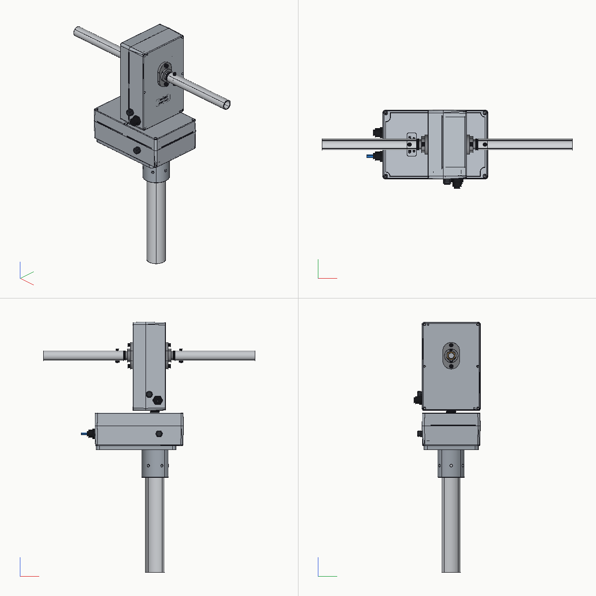
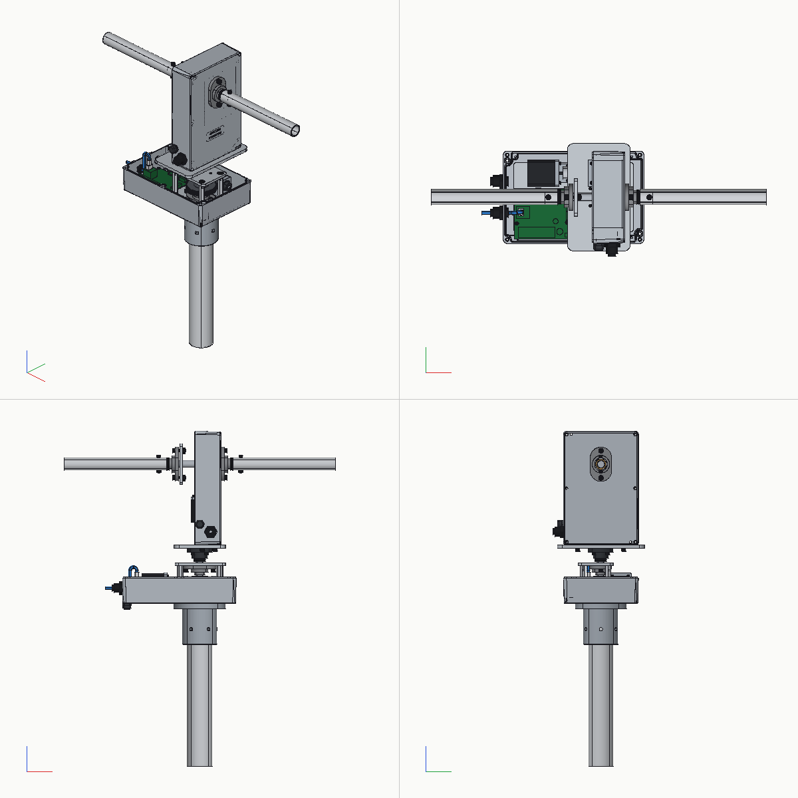
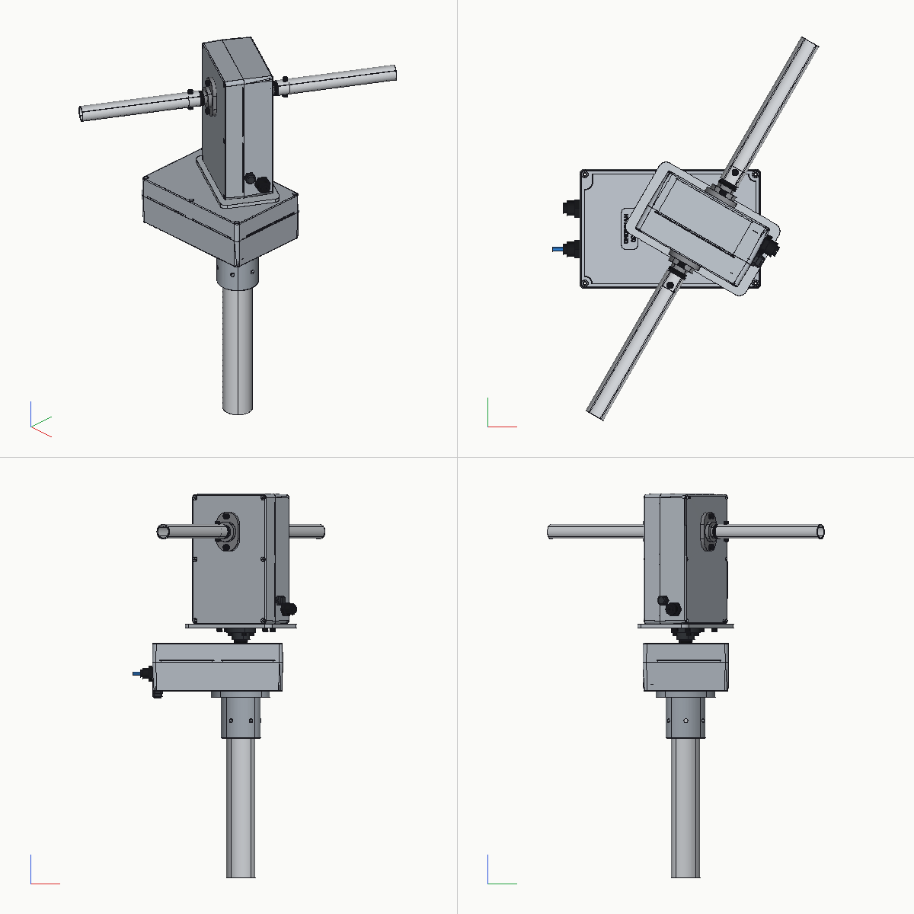
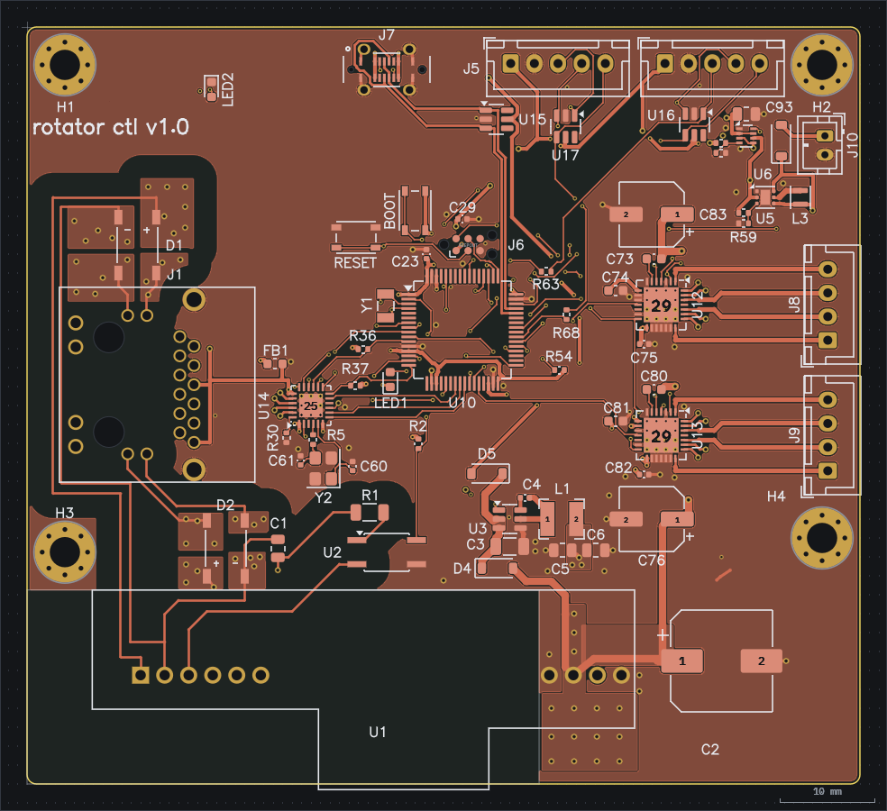

# Az/el antenna rotator

Weatherproof az/el rotator for small satellite yagis on a 25 mm crossboom, modelled in
[gcad](https://github.com/v0l/gcad). Housings are Hammond die-cast boxes; the made parts
are cut plates and a few turned and milled pieces, see `QUOTE.md`.







```sh
gcad rotator.gasm                         # viewer, joints `az` and `el`
gcad check rotator.gasm                   # build, interference and joint sweeps
gcad render rotator.gasm out.png --set cover=0   # without the two box lids
gcad bom rotator.gasm
gcad export rotator.gasm rotator.step
```

## Layout

- Two Hammond 1550Z220 die-cast IP66 boxes: the az box on the mast, the el box standing
  on the az spindle 5 mm above the az lid. Every other made part is a cut plate, two short
  turned shafts, the flange collar, the mast clamp and the two drive blocks.
- The mast clamp's flange covers the underside of the az box and seals to it with one
  O-ring cord. Everything inside the az box screws through the floor into it: the lower
  bearing, the drive block, four M8 posts, the control board and the battery holder.
- Az: 15 mm spindle in two KFL002 flange units, one on the box floor and one under a
  bearing plate on the posts. The spindle leaves the lid through a V-ring and ends inside
  the el box in a keyed flange collar with a set screw, bolted to a spot face on the el
  box's end wall.
- El: 15 mm shaft in KFL002 units bolted outside the el box floor and lid, with backing
  plates inside. Crossboom tubes slide over the shaft ends on bronze bushes and are cross-bolted.
  The el axis is 226 mm above the az box floor, and the el head sits 14.75 mm off the az axis
  so the collar's bolts land in the box body, not the lid.
- Each axis: KHK CG1-60R1 wheel on a keyed shaft, KHK SW1-R1 worm on an 8 mm shaft in two
  608s in `driveblock.gcad`, jaw-coupled to a StepperOnline 17HS15-1504-ME1K closed-loop
  NEMA17 with a built-in 1000 PPR magnetic encoder. Turn counting and its battery backup
  live on the control board.
- The boxes are `parts/std/hammond_1550z220_box.gcad` and `_lid.gcad`. Without
  Hammond's STEP they are drawn from its measurements. Download the STEP from
  https://www.hammfg.com/part/1550Z220, save it as `parts/vendor/1550Z220.stp`, and run
  with `--set hammond=1` to drill the real boxes; `./export.sh` uses it when present.

## Control board

`board/` is the controller in the az box: one PoE cable in, both motors and encoders out. An
STM32H563 with a LAN8720A PHY, two TMC2209 drivers on UART, a Silvertel Ag5424 PoE module, and
a CR123A cell that keeps the encoder counters alive through a power cut. It sits on four
aluminium M3 standoffs screwed into the mast clamp, which also carry its heat away. See
`board/DESIGN.md`.



## Sealing

The boxes seal on their own gaskets. Shafts leave through V-rings against the bearing
units or the lid, cables through IP68 M16 glands, and each box has an M12 breather vent.
The mast clamp seals the floor holes with a face O-ring.

## Strength

`sims/` holds gcad FEA of the KFL002 housing, the spindle, the el shaft and the el box on
its collar under a 120 km/h gusty-side wind, and the bearing loads against the KFL002
ratings; see `sims/README.md`. The worst bearing sees 768 N against a 2.9 kN static rating,
and the shafts stay under 90 MPa away from the singular spots. The worm wheels are the open
question.

## Ratings

60:1, 0.45 Nm motor, worm efficiency about 0.4: roughly 5 Nm usable at the output,
8-10 Nm at pull-out. KHK lists CG1-60R1 (cast iron) at 7.4 Nm at 100 rpm worm speed.
